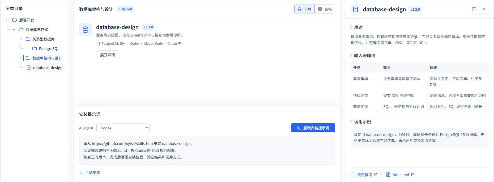

  

  

面向 Codex、Claude Code、Cursor 等 AI Agent 的 Skill 资源库与全局提示词。按任务查找规范，查看调用示例，生成所用工具的安装指引。

<a href="https://xytss.github.io/skills-hub/"><strong>进入在线工作台</strong>&nbsp;</a>

[使用流程](#使用流程) · [收录内容](#收录内容) · [反馈与贡献](#反馈与贡献)

## 使用流程

1. **选择 Skill**：打开 [在线工作台](https://xytss.github.io/skills-hub/)，按业务场景浏览，查看用途、输入输出与调用示例。
2. **生成安装指引**：在安装区选择 AI Agent，点击“复制安装提示词”，发送给对应工具执行安装。
3. **提交任务**：安装完成后，参照调用示例发起任务，例如使用 `database-design` 评审表结构或优化查询。

全局提示词在对应页面提供全文复制与下载，配置方法见 [提示词使用指南](prompts/README.md)。

## 工作台预览

左侧选择资源，中间查看 Skill 并生成安装指引，右侧阅读用途、输入输出与调用示例。

## 收录内容

当前提供 **35 个 Skill** 与 **1 套全局提示词**。

| 能力场景 | 收录资源 | 典型任务 | 在线入口 |
| --- | --- | --- | --- |
| 数据库建模与优化 | `database-design` · `v3.2.0` | 需求建模、表结构评审、索引设计与慢查询分析 | [查看 Skill](https://xytss.github.io/skills-hub/?skill=database-design#catalog) |
| 前端开发与数据可视化 | 34 个官方与社区 Skill，覆盖 Ant Design、Ant Design X、AntV、Umi 等 | 组件选型、主题定制、版本迁移、AI 对话界面、图表与信息图 | [浏览前端 Skill](https://xytss.github.io/skills-hub/?category=%E5%89%8D%E7%AB%AF%E5%BC%80%E5%8F%91#catalog) |
| Codex 全局行为约束 | `codex-win` · `v1.0.0` · Windows 11 / PowerShell 7 | 禁止执行文件删除操作、精简代码与界面；解释原理讲清因果，汇报改动简短具体 | [阅读与复制](https://xytss.github.io/skills-hub/prompts.html?prompt=codex-win) |

各 Skill 详情提供适用范围、版本核验信息、具体文档页与上游原文入口。

## 反馈与贡献

发现内容疏漏或希望补充 Skill，欢迎提交 [Issue](https://github.com/xytss/skills-hub/issues) 或 [Pull Request](https://github.com/xytss/skills-hub/pulls)。参与开发与内容维护请参阅 [贡献指南](CONTRIBUTING.md)。

## 开源协议

本仓库代码与自有资源采用 [MIT License](LICENSE)。收录的上游 Skill 按各自仓库的许可证使用。
