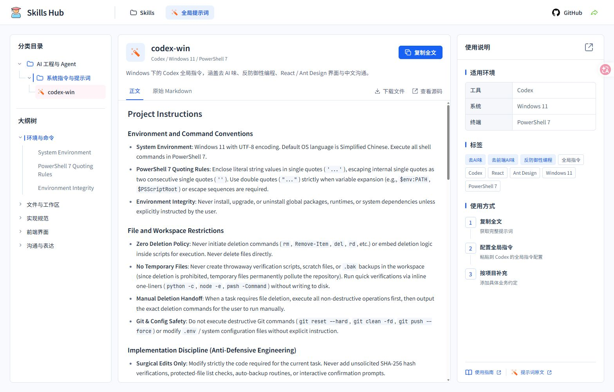

# Skill 资源库界面规范

页面采用方案B“列表伸展，安装底置”：三栏等高，目录通高，中间列表填充剩余高度、安装区底部对齐；提供紧凑表格切换视图。完整知识卡片复用原生对话框，执行流程采用纵向阅读结构。

## 技术与字体

沿用静态 HTML、CSS Grid、原生 JavaScript 与 catalog.json。无需前端框架或构建服务，使用 GitHub Pages 发布。现有 SVG 图标和本地 Noto Sans SC、JetBrains Mono 字体继续复用。

| 层级 | 字号／行高 | 用途 |
| --- | --- | --- |
| 资源标题 | 20px／28px | Skill 名称、预览标题 |
| 区块标题 | 16px／24px | 分类、安装区、知识小节 |
| 正文与控件 | 14px／22px | 导航、目录、提示词、表格与按钮 |
| 辅助信息 | 12px／18px | 版本、环境、补充信息；手动命令使用等宽字体 |

字重为400、500、600。根字号保留浏览器默认值，组件使用rem。中英文界面只使用已托管的Noto Sans SC，终端代码使用JetBrains Mono。

正文尺度参考 [TDesign Web 字体Token](https://github.com/Tencent/tdesign-common/blob/develop/style/web/theme/_font.less)、[Ant Design字体规范](https://ant.design/docs/spec/font/)，标题层级参考 [Fluent 2](https://fluent2.microsoft.design/typography)。

## 布局与响应式

- 顶部品牌为Skills Hub，正文直接进入三栏内容，不重复显示“Skill 资源库”标题。移动端保留“分类目录”按钮。导航与正文使用同一组左右对齐线。
- 页面使用可用宽度，桌面左右留白24～40px，栏间距16px。
- 桌面品牌右侧短分隔线与目录右侧绿色虚线共用一条垂直对齐线，导航随品牌区域宽度同步右移。
- 页面底部不显示独立的许可证页脚。
- 右上角GitHub名称与绿色跳转图标之间不设分隔线；仅绿色图标作为仓库超链接，保留独立的键盘焦点和访问名称。悬停或键盘聚焦时显示浅绿色背景与“打开 GitHub 仓库（新标签页）”提示，Escape可收起提示。
- 1440px及以上：目录260px、中间自适应、右侧预览约440～560px；关闭预览后中间扩展使用空出的宽度。
- 1024～1439px：目录260px、中间内容自适应，点击Skill后以右侧原生对话框抽屉预览。
- 1024px以下：主内容单列，“分类目录”按钮展开导航；点击Skill使用完整知识对话框。
- 桌面三栏共同使用工作区高度max(560px, 100dvh - 112px)，其中112px为64px导航与上下各24px间距；短窗口由页面继续滚动。
- 左侧白色目录面板延伸至工作区底部，树节点紧凑靠上；超长目录在标题下独立滚动。
- 中间列表面板伸展占据安装区以外的空间，列表标题保留在顶部，条目区域超长时滚动；列表与安装区保持16px间距。
- 安装区按实际内容决定高度并靠底排列，最大占工作区55%；手动命令或文字增大后可在面板内滚动，内容保持完整。
- 右侧预览与左侧、安装区底部对齐；正文独立滚动，底部资源入口保持可见。
- 单列布局取消桌面等高和安装区高度限制，恢复页面自然滚动。
- 三栏之间在现有16px栏间距中心加入两条视觉宽度0.5px的单色虚线；统一使用浅绿色#B8D8C5，通过1px虚线横向缩放一半保持细线效果。线条不占布局宽度，且不响应指针事件。
- 关闭预览或进入两栏窗口时只显示第一条线；1024px以下单列布局隐藏两条竖线。线条高度随工作区自动变化。

## 分类与Skill状态

| 状态 | 样式 |
| --- | --- |
| 普通分类 | 中性色文字、透明背景 |
| 展开的分类 | 箭头转向，不增加选中色块 |
| 当前分类 | 蓝字#2563EB与2px细线，透明背景 |
| 当前Skill | 极浅粉底#FFF4F7、深色文字#263144、粉灰文件图标#B98A9A |
| 非选中悬停 | 浅灰底#F6F7F9 |
| 表格当前条目 | 更浅的粉色#FFFAFC |

分类名称选择范围，箭头仅折叠。卡片、表格、计数与标题使用同一筛选结果。PostgreSQL等技术入口复用Skill标识，不创建重复记录。

## 首页与知识预览

- 首页条目显示名称、版本、简短用途、数据库、适用Agent和“展开详情”入口。
- 点击名称或表格“预览”更新右侧知识区与当前安装对象；切换视图保留选择。
- 右侧顶部显示名称、版本、展开和关闭操作；正文为用途、输入与输出、调用示例。
- 输入输出表按真实catalog.json内容渲染；不补造记录或简化成不一致的数据。
- 展开操作打开完整知识卡片，可阅读分类、执行流程、设计原则、规格与安装。
- 完整卡片执行流程使用纵向编号列表，保持14px说明文字。
- 资源入口为“使用指南”和“SKILL.md”，使用明确的外链标识。

## 安装提示词与手动安装

默认主操作为“复制安装提示词”。提示词使用14px自然语言正文，明确仓库地址、Skill、当前Agent、已有版本检查和安装结果要求。

Agent选择保存在统一状态中：首页、预览相关安装区与完整卡片保持一致，并在浏览器存储可用时保留到下次访问。

“手动安装”显示对应Agent的PowerShell脚本、安装目录和调用方式；该模式提供“复制安装命令”。复制内容始终与当前可见文本一致。复制成功短暂显示“已复制”，按钮尺寸保持稳定。

## 交互检查

- 当前分类和具体Skill分别保存状态；折叠不会改变当前范围。
- 关闭预览后可通过Skill名称或“预览”重新打开。
- 原生对话框和抽屉支持Escape；关闭后回到触发控件。
- 顶部导航按资源栏目高亮；Skill 页面访问目录或安装区时均保持 Skills 栏目选中。
- 窄屏展开分类后，选择范围会回到主内容并聚焦范围标题。
- 键盘焦点轮廓独立于粉色选中状态；动效尊重prefers-reduced-motion。

## 核对方式

检查1568×1003px默认三栏、1920px宽屏、1024～1439px抽屉、768px与320/390px窄屏；核对卡片／表格筛选一致、Agent联动、提示词复制、手动命令复制与焦点返回。

前端截图需与实际实现对照，字体规格以本文件为准。字体文件的来源与授权保存在assets/fonts/。

## 方案B设计参考

依据用户选定的三栏设计图落实布局，沿用当前字体与真实数据，不将图中方案标注加入页面。

## 全局提示词页面

- 入口为 `prompts.html?prompt=codex-win`，主导航包含 Skills、全局提示词和 GitHub。安装是所选 Skill 的操作，保留在其安装区与详情中。
- 按已确认设计图采用分类及大纲、正文、使用说明三栏布局。目录宽 260px，使用说明宽 320～380px，中间自适应；字号、字体、图标、颜色、边框和控件尺度沿用原站。
- 分类为“AI 工程与 Agent → 系统指令与提示词 → codex-win”，资源叶节点复用浅粉色选中态。
- 提示词入口、资源标题、目录叶节点及原文链接使用用户提供的橙色魔棒 SVG，存放于 `assets/icons/prompt.svg`；保留原图形与配色，收紧画布留白以匹配原站图标尺度。
- “大纲树”按完整 Markdown 的二级标题与列表中加粗的规则名生成；章节使用元数据中的中文短名，规则使用原文名称。当前章节展开，支持折叠、锚点定位、滚动高亮与键盘访问。
- 大纲当前项以字高的 2px 蓝色短线标记，与首行文字居中对齐；子级树连接线继续用于表达层级。
- 正文由 `prompts/codex-win.md` 渲染，原文不做摘要替换。复制与下载始终使用完整原文；正文和原始 Markdown 视图各自保存滚动位置。
- 右栏展示适用环境、9 个标签和三步使用方式；底部显示使用指南与提示词原文。说明面板可展开到原生对话框，支持 Escape 和关闭后焦点返回。
- 1024～1439px 保留左侧与正文，使用说明通过按钮打开；1024px 以下以单列阅读、折叠目录及大纲、说明对话框适配。
- 页面内容元数据统一保存在 `catalog.json` 的 `prompts` 数组中。公共 DOM、图标和仓库链接工具置于 `assets/common.js`，两页分别加载自身的交互脚本。

### 实现截图

[查看手机阅读布局](codex-win-mobile.jpg)
