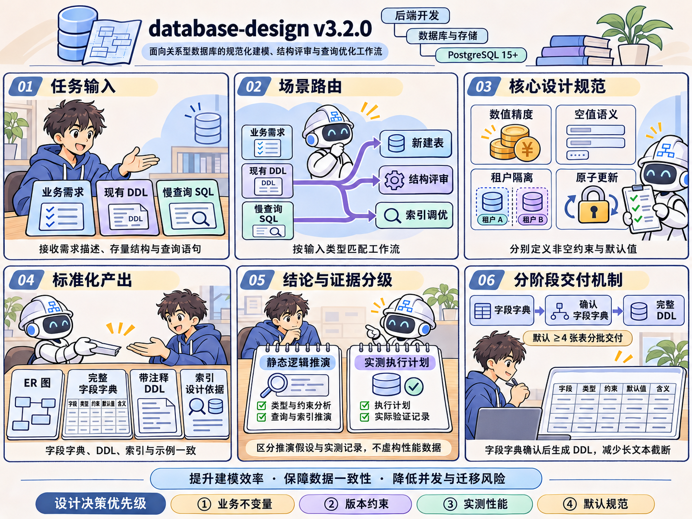

# 数据库设计

`database-design` · 3.2.0 · PostgreSQL 15+

本Skill面向后端开发中的数据库建模、结构评审与查询优化。开发者提供业务需求、现有DDL或慢SQL后，按对应流程整理结构方案、约束、索引依据与验证事项。

## 用在什么地方

| 输入材料 | 对应场景 | 交付内容 |
|---|---|---|
| 新业务需求 | 从需求到表结构 | 实体关系、完整字段字典、约束及DDL |
| 现有DDL或表结构 | 结构评审与渐进重构 | 问题清单、变更方案及兼容与恢复安排 |
| 慢SQL及表结构 | 查询诊断与索引优化 | 诊断依据、改写建议、索引及验证方案 |

## 主要功能

- 说明实体、关联与字段含义，分别处理历史快照和当前态冗余。
- 核对精确数值、缺项与默认值、租户归属、状态更新和并发控制。
- 整理软删除、唯一性、历史数据及结构迁移的适用要求。
- 分别记录静态推演、实际执行证据和校验结果，检查字典、DDL、索引与示例的一致性。

## 怎么使用

在支持Skill的开发工具中加载[SKILL.md](SKILL.md)，直接提供相应材料，例如：

- “为项目管理业务设计数据库，包含项目、成员与任务，目标PostgreSQL 15。”
- “评审这份DDL，重点检查业务唯一性、租户隔离和存量变更影响。”
- “结合表结构和执行计划，分析这条SQL并给出索引建议。”

涉及4张及以上表时默认分批交付，先审阅完整字段字典，再生成DDL。

## 决策顺序与预期用途

设计决策优先级从高到低：

1. 业务不变量与数据正确性。
2. 已确认的技术与版本约束。
3. 有证据的性能瓶颈。
4. 默认工程规范。

本Skill用于提升建模效率、保障数据一致性并降低并发与迁移风险。业务定义、数据库运行及性能结果分别通过设计审阅、测试和实际证据核对。

## 文件

- [执行规范](SKILL.md)
- [概念图](assets/overview.png)
